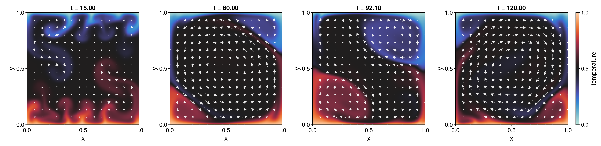

# DataDrivenFlowROM.jl

[](https://github.com/franabaajo/DataDrivenFlowROM.jl/actions/workflows/ci.yml)
[](https://julialang.org/)
[](LICENSE)

> **New to reduced-order modelling?** Read the
> [non-technical project overview](docs/nontechnical_overview.md) for the
> problem, why it matters, what I built, and the main results.

Data-driven reduced-order modelling of two-dimensional incompressible turbulent
flows in Julia.

This repository accompanies my Bachelor End Project in Applied Mathematics and
Applied Physics at Eindhoven University of Technology. It investigates whether
expensive high-fidelity flow simulations can be compressed into fast,
interpretable dynamical systems without explicitly assembling the full-order
polynomial operators. The central comparison is between trajectory-based
Operator Inference, exact Operator Inference, and intrusive Galerkin projection,
all using reduced spaces constructed with Proper Orthogonal Decomposition (POD).

The methods are evaluated on two challenging flow problems:

- collision of a vortex dipole with a no-slip wall at `Re = 2500`;
- Rayleigh-Benard convection at `Ra = 1.6e7`, including a reversal of the
  large-scale circulation.

Full-order data are generated with the MIT-licensed
[IncompressibleNavierStokes.jl](https://github.com/agdestein/IncompressibleNavierStokes.jl)
solver on an energy-conserving staggered finite-volume grid. The ROM algorithms,
experiment automation, diagnostics, analysis, and case studies in this
repository are my contribution.

The main finding is that exact Operator Inference recovers the corresponding
intrusive reduced operators to floating-point accuracy in both cases. The
remaining trajectory error is therefore dominated by the reduced space, POD
truncation, and coverage of the relevant flow regimes—not by identification of
the reduced operators. A global POD basis captures the energetic dipole dynamics
but struggles with localized near-wall vorticity, while the circulation reversal
requires scheduled local models for the pre-reversal, transition, and
post-reversal regimes.



## What is Operator Inference?

Operator Inference (OpInf) is a non-intrusive, physics-structured model-reduction
method introduced by Benjamin Peherstorfer and Karen Willcox in
[Data-driven operator inference for nonintrusive projection-based model reduction](https://doi.org/10.1016/j.cma.2016.03.025)
(2016). POD first represents a high-dimensional flow state using a small vector
of reduced coordinates, `a(t)`. OpInf then learns the coefficients of a reduced
dynamical system directly from state and time-derivative data. For the flows in
this project, the known Navier–Stokes structure leads to an affine-quadratic
model,

```text
da/dt = c + L*a + Q*(a ⊗ a),
```

so training becomes a linear least-squares problem for the constant, linear,
and quadratic operators. Unlike an unconstrained black-box predictor, OpInf
fixes the algebraic form from the governing physics and learns only its reduced
coefficients; unlike intrusive Galerkin projection, it does not require direct
access to assembled full-order operators.

The exact variant studied here follows Henrik Rosenberger, Benjamin Sanderse,
and Giovanni Stabile,
[Exact operator inference with minimal data](https://doi.org/10.48550/arXiv.2506.01244).
It constructs rank-ensuring reduced states and queries the full-order solver for
one step from each state. When the resulting regression system has full rank,
the intrusive Galerkin operators can be recovered to numerical round-off with a
minimal set of purpose-built samples.

## Highlights

- Energy-weighted POD consistent with the solver's staggered finite-volume grid.
- Centered POD and fluctuation-energy rank selection for thermal flows.
- Affine-quadratic and quadratic reduced dynamical systems.
- Exact OpInf through rank-ensuring one-step full-order queries.
- Matrix-free intrusive Galerkin operators for verification.
- Space-local POD with sparse bases and configurable domain partitions.
- Scheduled local ROMs for pre-reversal, transition, and post-reversal regimes.
- Streamed, memory-mapped snapshots for large simulations.
- CPU/GPU selection, TOML configurations, deterministic run identifiers, and
  experiment registries.
- Reproducible physical diagnostics: kinetic energy, enstrophy, Nusselt number,
  and normalized angular momentum.

## Key results

| Experiment | Result |
|---|---|
| Dipole exact OpInf | Intrusive linear and quadratic operators recovered with relative errors of `2.30e-13` and `1.77e-14` |
| Rayleigh-Benard exact OpInf | Local affine-quadratic operators recovered to approximately `1e-14`-`1e-15` relative error |
| Dipole online performance | Recorded median speedups of about `15,100x` at rank 22 and `50,500x` at rank 13 |
| Circulation reversal | The `eta = 0.99` switched model achieved mean relative state error `0.16034` and angular-momentum RMSE `0.07033` |
| Post-training prediction | Stable continuation from training end `t = 150` to `t = 300`, with mean post-training state error `0.18786` |

The timings above measure online advancement and exclude full-order data
generation. See [Scientific findings](docs/methodology.md) for interpretation
and limitations.


## Repository map

```text
src/workflows/                 reusable POD, FOM-query, and ROM algorithms
src/dipole/                    dipole configuration, simulation, ROM, and diagnostics
src/rayleighbenard/            thermal-flow configuration, ROM, switching, and diagnostics
experiments/                   executable case studies and TOML configurations
analysis/                      scripts used to produce the reported statistics
results/                       curated figures and compact result tables
test/                          contribution-focused numerical and I/O tests
report/                        bachelor thesis
docs/                          methodology and full reproducibility instructions
```

## Quick start

Install Julia 1.10 or newer, clone the repository, and instantiate its
environment:

```bash
git clone https://github.com/franabaajo/DataDrivenFlowROM.jl.git
cd DataDrivenFlowROM.jl
julia --project=. -e 'using Pkg; Pkg.instantiate()'
```

Run the lightweight CPU dipole pipeline:

```bash
DIPOLE_BACKEND=cpu bash scripts/dipole.sh run-all
```

On Windows PowerShell, the equivalent commands are:

```powershell
$env:DIPOLE_BACKEND = "cpu"
julia --project=. experiments/DipoleWallCollision/scripts/dipole_tasks.jl run-all `
  experiments/DipoleWallCollision/configs/demo_fom.toml `
  experiments/DipoleWallCollision/configs/demo_rom.toml
```

The demo uses a deliberately small grid as a smoke test. Thesis-scale
configurations are retained as `fom_base.toml` and `rom_base.toml`; they require
substantially more memory and compute time.

For Rayleigh-Benard convection, first generate a FOM run:

```bash
RAYLEIGH_BACKEND=cpu bash scripts/rayleighbenard.sh run-fom
```

The command prints the deterministic run identifier needed by `run-rom`.

## Methods at a glance

```text
Full-order simulation
        |
        v
weighted snapshots --> POD / centered POD --> reduced coordinates
                                                |
                    +---------------------------+------------------+
                    |                           |                  |
                    v                           v                  v
          trajectory OpInf             exact OpInf       intrusive Galerkin
                    |                           |                  |
                    +---------------------------+------------------+
                                                |
                                                v
                              adaptive reduced-order simulation
                                                |
                                                v
                          physical diagnostics and FOM comparison
```

Exact OpInf and intrusive projection agree when they use the same basis and
polynomial feature space. That agreement does not imply exact recovery of the
full-order trajectory: POD truncation, regime coverage, and local structures
remain important sources of error.

## Tests

```bash
julia --project=. -e 'using Pkg; Pkg.test()'
```

The tests cover weighted space-local POD, snapshot-file integrity, conductive
Nusselt-number sanity checks, and Rayleigh-Benard training-window behavior.

## Report and reproducibility

- [Bachelor thesis](report/Francisco_Abajo_Lis_Bachelor_Thesis.pdf)
- [Methodology and findings](docs/methodology.md)
- [Space-local POD](docs/space_local_pod.md)
- [Reproducing the experiments](docs/reproducibility.md)
- [Software architecture](docs/architecture.md)

Large full-order snapshots are intentionally not versioned. The repository
contains the configurations and scripts needed to regenerate them, while the
compact numerical summaries used in the thesis are retained under `results/`.

## Scope and limitations

- The `256 x 256` Rayleigh-Benard trajectory used for the switched-ROM study is
  a selected reduced-modelling trajectory, not a grid-converged prediction at
  the stated Rayleigh number.
- Switching times are derived from the training FOM; the demonstrated model is
  scheduled rather than fully autonomous.
- High-rank quadratic ROMs remain expensive without hyper-reduction.
- Exact operator recovery removes identification error relative to intrusive
  projection, but not reduced-basis truncation or closure error.

## Authorship and attribution

Copyright (c) 2026 Francisco Abajo Lis.

This repository is licensed under the MIT License. The full-order solver is a
separate upstream project with its own authors and license. See
[THIRD_PARTY_NOTICES.md](THIRD_PARTY_NOTICES.md) and `LICENSE-UPSTREAM`.

