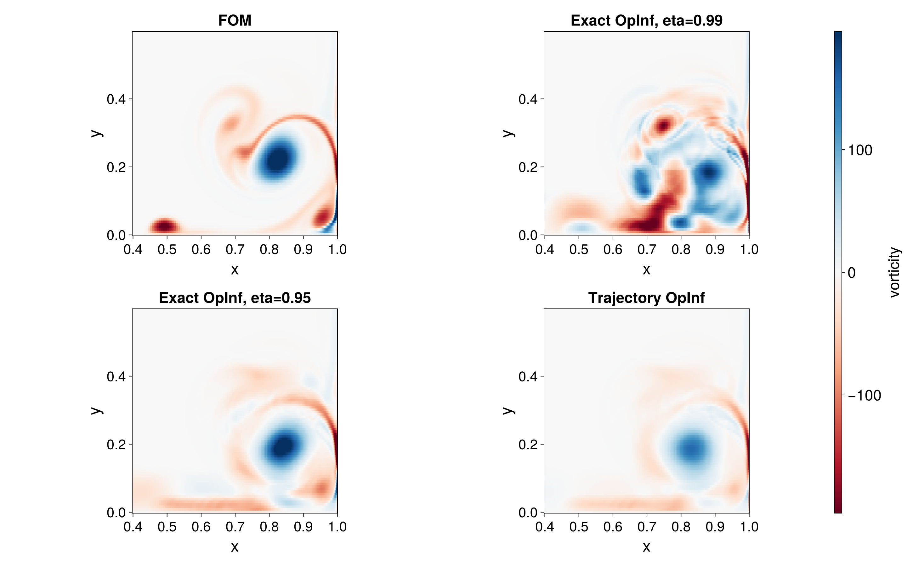
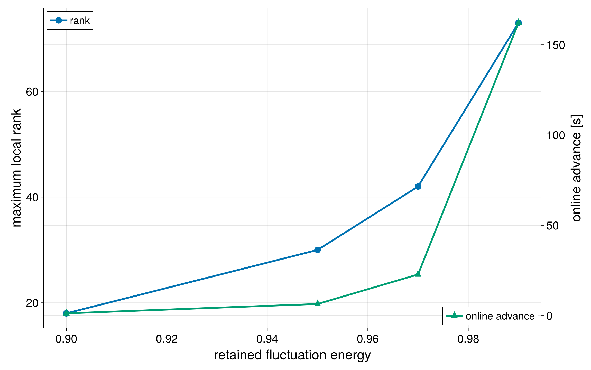
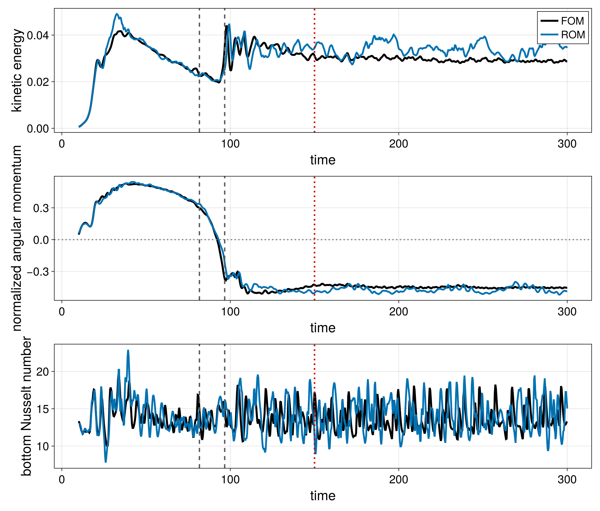

# Methodology and scientific findings

## Problem formulation

The project treats a semi-discrete incompressible-flow model as a source of
full-state snapshots and one-step state-derivative queries. The reduced state is
represented as

```text
x(t) approximately mu + Phi * a(t),
```

where `Phi` is a POD basis orthonormal in the finite-volume mass inner product.
For thermal flows, `mu` is the temporal mean and rank selection is based on
fluctuation energy so that the mean temperature profile does not hide
dynamically relevant structures.

The inferred reduced dynamics have quadratic or affine-quadratic form:

```text
da/dt = L*a + Q*(a tensor a)
da/dt = c + L*a + Q*(a tensor a).
```

Only unique symmetric quadratic features are stored.

## Three operator constructions

1. **Trajectory OpInf** fits the operators from projected state and derivative
   samples using regularized least squares. Its identifiable rank is limited by
   the number of independent trajectory samples.
2. **Exact OpInf** generates reduced states whose polynomial feature matrix has
   full row rank, lifts them into the full state space, and performs controlled
   one-step FOM queries. It is designed to recover the corresponding intrusive
   operators to numerical precision.
3. **Intrusive Galerkin** evaluates the full-order right-hand side at basis
   states and projects the result without explicitly assembling the enormous
   full-order polynomial tensor.

## Dipole-wall collision

The validated full-order calculation uses a `1536 x 1536` stretched grid at
`Re = 2500`. Exact OpInf and intrusive Galerkin agree to round-off, but the
global basis has difficulty representing thin near-wall vorticity layers after
impact. Retaining more global POD energy does not automatically improve every
localized diagnostic.

The result is useful because it separates operator-identification error from
reduced-space error: once exact OpInf matches the intrusive model, the remaining
discrepancy is primarily caused by POD truncation and missing closure effects.



## Rayleigh-Benard circulation reversal

One global basis is poorly suited to a trajectory that changes large-scale
circulation direction. Three centered local models are therefore trained for
the pre-reversal, transition, and post-reversal regimes and connected by fixed
switching times derived from the FOM angular-momentum signal.

The retained fluctuation-energy study reveals a sharp accuracy-cost trade-off.
The `eta = 0.99` model uses local ranks `72/22/73` and is much more expensive
than lower-rank alternatives, but it is the only tested model that reliably
reconstructs the state, kinetic energy, and circulation reversal together.



## Prediction beyond training

The final post-reversal local model is trained only through `t = 150` and then
advanced to `t = 300`. It remains stable and preserves the sign and approximate
magnitude of the large-scale circulation. Kinetic-energy and Nusselt errors
increase after the training horizon, showing that wall-gradient and small-scale
quantities are less reliable than the integral circulation diagnostic.



## Main interpretation

Exact OpInf is an accuracy-oriented data-driven route to the same sampled
affine-quadratic dynamics obtained by intrusive projection. Practical surrogate
quality is then controlled by the reduced space, retained fluctuation energy,
training-regime coverage, and online treatment of nonlinear terms.

